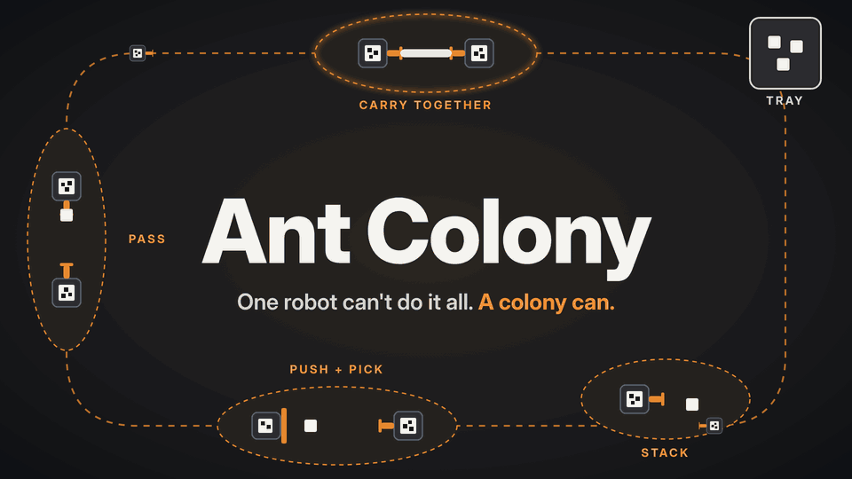
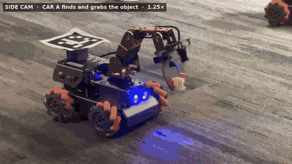
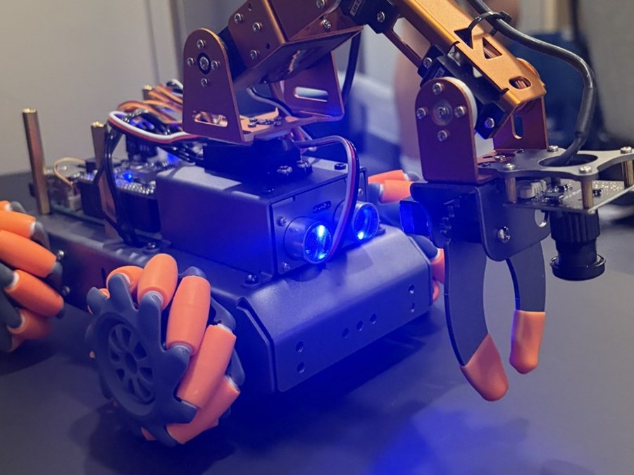
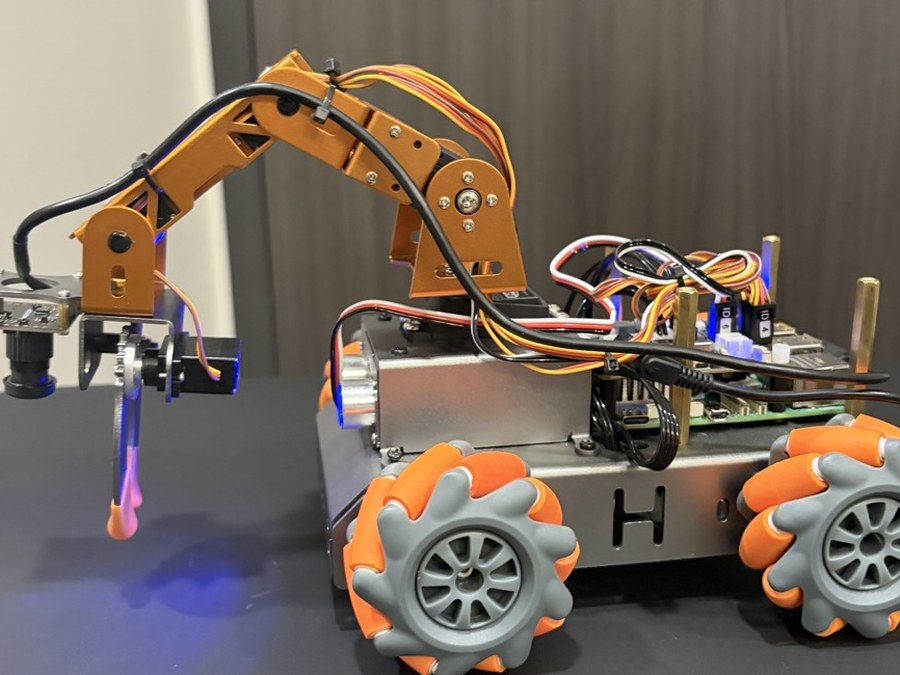
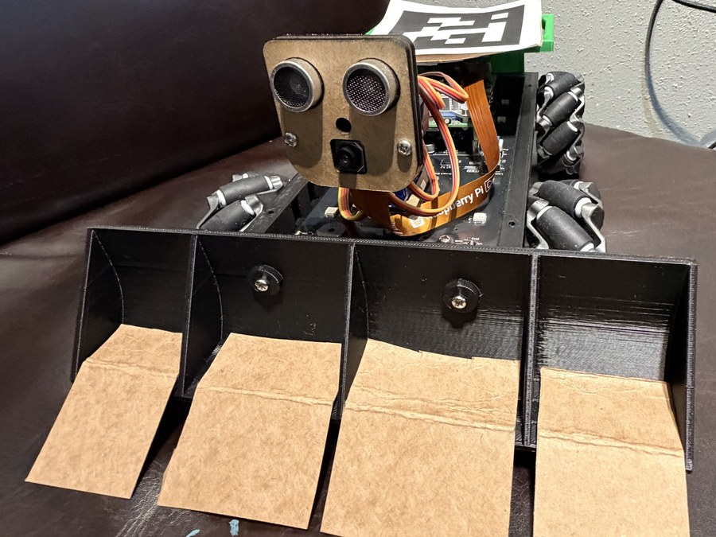
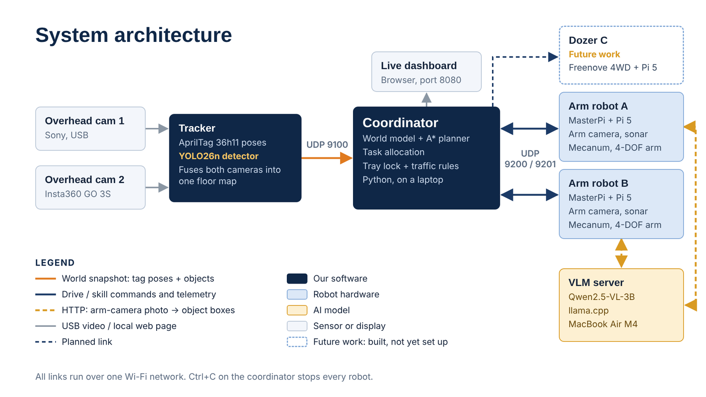
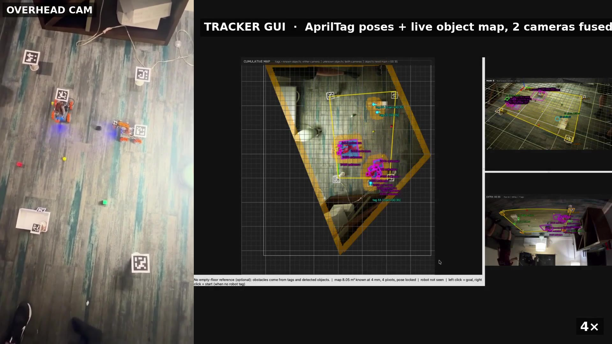
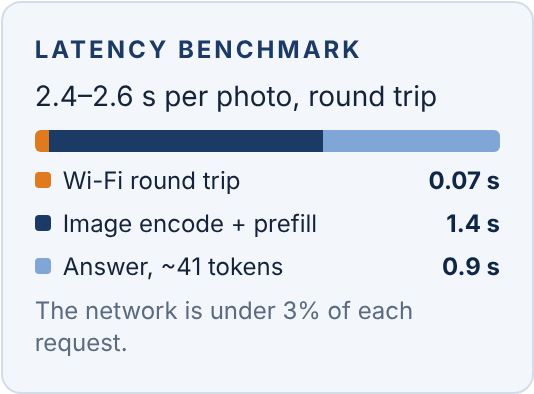

<p align="center">
  
</p>

<h1 align="center">AntColony</h1>

<p align="center"><b>One robot can't do it all. A colony can.</b></p>

<p align="center">
  <a href="https://youtu.be/3LI5c8XD4fA">▶ Watch the demo video</a>
</p>

AntColony is a low-cost testbed for cooperative robot teams. A shared overhead view, a central coordinator and on-board AI turn a handful of cheap, different robots into one team that finds objects, picks them up and carries them where they need to go.

Built in 36 hours at **HackPrinceton Fall 2026** (Princeton University, November 13–15, 2026). We will keep working on it after the hackathon. 

<p align="center">
  
</p>

## Why we built it

We want to recreate a swarm.

Local vision-language models (VLMs), GPS and satellite networks such as Starlink are maturing fast, and the pieces for robots that work together on their own are starting to fall into place. Think of the situations where that matters most:

- **After a natural disaster** such as an earthquake, hurricane or mudslide: clearing roads, removing debris and rubble, and scouting routes that are safe to pass.
- **On the front line:** moving supplies and evacuating the wounded.
- **In unknown terrain:** exploring places that are too dangerous for people to go first.

In each of these, a mixed team of drones, arm robots, bulldozers and survey vehicles, linked by satellite relay and guided by VLMs, could work semi-autonomously or even fully autonomously. That future is no longer far away.

With limited equipment and budget, our team built a small proving ground for exactly this kind of system: miniature arm robots and a mini bulldozer, AprilTags, and cameras mounted above the arena to stand in for drones overhead. We use it to train and test how unmanned robots can cooperate.

That is what Ant Colony means: **like ants, each robot has a clear job, and together they take on high-risk work so people don't have to.**

## The robots

|  |  |  |
| :---: | :---: | :---: |
| **Arm robot A** | **Arm robot B** | **Dozer C** (joining next) |
| Hiwonder MasterPi, Raspberry Pi 5<br>mecanum drive, 4-DOF arm, arm camera | Same build as A | Freenove 4WD, Raspberry Pi 5<br>pushes far-away objects in |

## How it works

<p align="center">
  
</p>

The system has three layers.

- **Sense.** Two cameras above the arena (Sony and Insta360 GO 3S) play the role of drones. The tracker locates every robot and the tray by their AprilTags, finds objects on the floor with a YOLO model we trained ourselves, and fuses both cameras into one live map.
- **Decide.** A central coordinator reads that map, gives each robot a job, plans paths with A*, and enforces traffic rules, for example only one robot at the tray at a time. A live dashboard runs in the browser.
- **Act.** Each robot runs its own agent. For the last few centimeters it relies on its own arm camera: it sends a photo to a vision-language model, which says where the object is, and the arm grabs it. A missed grab is looked at again and retried.

<p align="center">
  
</p>

## The AI inside

| | |
| --- | --- |
| **Vision-language model** | Qwen2.5-VL-3B, 4-bit, served locally by llama.cpp. No cloud needed. |
| **Off the robot, onto a laptop** | 20–28 s per photo on the Raspberry Pi 5, about 2.4 s on a laptop on the same Wi-Fi |
| **Network cost** | Each request takes 2.4–2.6 s round trip; Wi-Fi is only 0.07 s of that, under 3% |
| **Object detector (YOLO26n)** | 0.994 mAP50 on held-out test images; 0 false detections on 200 empty-carpet images |

<p align="center">
  
</p>

## What we demonstrated

- ✅ One robot finds an object, picks it up, carries it to the tray and drops it over the rim.
- ✅ Two robots work at the same time without getting in each other's way.
- ✅ Two robots carry one long pole together, something neither could move alone.
- ✅ In our simulator, all 8 random layouts were cleared with zero robot-to-robot contact.

## Limits and next steps

This is a hackathon prototype, tested on a carpeted hotel-room arena.

- **Not done yet:** Dozer C is built but not yet part of the system; grasp success rate and task time have not been measured systematically; coordination is centralized.
- **Next:** bring the dozer in, measure real-world performance, move toward more decentralized coordination, and scale to more robots and larger areas.

## Try it without hardware

```bash
pip install numpy
python -m antcolony.sim --objects 6      # terminal 1: simulated cameras and robots
python -m antcolony.coordinator --sim    # terminal 2: coordinator; open http://localhost:8080
```

Running on real robots (deployment, calibration, cameras, message formats) is covered in **[docs/SETUP.md](docs/SETUP.md)**.

## Repository layout

```
antcolony/        coordinator: world model, path planning, task allocation, dashboard, simulator
cam_control/      overhead tracker GUI, YOLO training, multi-camera fusion
robot/            on-robot agent, hardware drivers, vision-guided grasping
tracker_bridge/   tracker → coordinator publisher
tests/            end-to-end tests
docs/SETUP.md     full technical reference
```

## Team and acknowledgments

Built by **Zihan Zhao**, **Jonathan Hsiao**, **Junbo Zhao** and **Allen Shen** of Penn State.

Special thanks to **Dr. Xiaozhen Wang**, Associate Professor of Electrical Engineering at Penn State, for providing equipment and support.
